# Alur Pengguna (User Flow) Web App ProjectMatch

Dokumen ini mendefinisikan alur kerja menyeluruh (*end-to-end user flow*) untuk platform **ProjectMatch: Jaringan Kolaborasi Lintas Kampus**. Flowchart ini menjadi acuan bersama bagi tim **UI/UX**, **Frontend**, dan **Backend** dalam merancang antarmuka, routing/state antarmuka, serta arsitektur API dan basis data.

---

## 1. Flowchart Mermaid.js (Alur Utama Pengguna & Sistem)

```mermaid
flowchart TD
    %% Inisiasi & Style Classes
    classDef startEnd fill:#10B981,stroke:#047857,stroke-width:2px,color:#FFFFFF,font-weight:bold;
    classDef seeker fill:#DBEAFE,stroke:#2563EB,stroke-width:2px,color:#1E40AF;
    classDef owner fill:#F3E8FF,stroke:#9333EA,stroke-width:2px,color:#6B21A8;
    classDef platform fill:#F1F5F9,stroke:#475569,stroke-width:2px,color:#0F172A;
    classDef decision fill:#FEF3C7,stroke:#D97706,stroke-width:2px,color:#92400E,font-weight:bold;
    classDef reject fill:#FFE4E6,stroke:#E11D48,stroke-width:2px,color:#9F1239;
    classDef reputation fill:#FEF08A,stroke:#CA8A04,stroke-width:2px,color:#854D0E,font-weight:bold;

    %% FASE 1: ONBOARDING
    subgraph P1 ["1. Onboarding & Setup Profil Mahasiswa"]
        Start(["Mulai / Akses Web"]):::startEnd
        Auth["Login / Registrasi via SSO Kampus atau Email"]:::seeker
        FillProfile["Lengkapi Profil Wajib:<br>• Asal Kampus & Jurusan<br>• Minat (Lomba / Startup / Kepanitiaan)<br>• Skill & Ketersediaan Jam"]:::seeker
        SaveProfile["Backend: Simpan Profil & Parameter Eligibilitas"]:::platform
        
        Start --> Auth --> FillProfile --> SaveProfile
    end

    %% FASE 2: PERCABANGAN PERAN
    subgraph P2 ["2. Dashboard & Pemilihan Peran"]
        Dashboard["Dashboard Utama"]:::seeker
        RoleChoice{"Apa yang ingin<br>dilakukan user?"}:::decision
        
        SaveProfile --> Dashboard --> RoleChoice
    end

    %% FASE 3A: JALUR PROJECT OWNER
    subgraph P3A ["3A. Jalur Project Owner (Inisiator Proyek)"]
        CreateProj["Formulir Buat Proyek Baru:<br>• Judul, Kategori & Target Deadline<br>• Role yang Dicari & Kuota Anggota<br>• Syarat Eligibilitas (Kampus/Jurusan/Skill)"]:::owner
        PublishProj["Klik Publikasikan Proyek"]:::owner
        SaveProjectState["Platform: Simpan Proyek<br>Status: OPEN_RECRUITMENT"]:::platform
        MatchingEngine["Matching Engine:<br>Cocokkan Kriteria Proyek vs Profil User Lain"]:::platform
        
        RoleChoice -->|"Buat Proyek"| CreateProj
        CreateProj --> PublishProj --> SaveProjectState --> MatchingEngine
    end

    %% FASE 3B: JALUR PROJECT SEEKER
    subgraph P3B ["3B. Jalur Project Seeker (Pencari Tim)"]
        ExploreFeed["Eksplorasi Feed Proyek:<br>• Tab Rekomendasi (Sesuai Eligibilitas)<br>• Filter Manual (Kategori, Role, Remote/Onsite)"]:::seeker
        ViewDetail["Buka Halaman Detail Proyek:<br>• Deskripsi & Timeline<br>• Posisi yang Tersedia<br>• Profil & Reputasi Owner"]:::seeker
        CheckEligibility{"Apakah User<br>Eligible?"}:::decision
        Ineligible["Tombol Lamar Dinonaktifkan<br>(Tampilkan Syarat yang Belum Terpenuhi)"]:::reject
        ApplyModal["Formulir Pendaftaran:<br>• Pilih Role yang Dilamar<br>• Tulis Pesan Pengantar / Pitch Singkat<br>• Lampirkan Portofolio Tambahan"]:::seeker
        SubmitApply["Submit Lamaran Proyek"]:::seeker

        RoleChoice -->|"Cari Tim / Proyek"| ExploreFeed
        MatchingEngine -.->|"Rekomendasi Relevan"| ExploreFeed
        ExploreFeed --> ViewDetail --> CheckEligibility
        CheckEligibility -->|"Tidak"| Ineligible
        CheckEligibility -->|"Ya"| ApplyModal --> SubmitApply
    end

    %% FASE 4: SELEKSI & PEMBENTUKAN TIM
    subgraph P4 ["4. Seleksi & Pembentukan Tim"]
        NotifOwner["Notifikasi Realtime ke Owner:<br>Ada Pelamar Baru!"]:::platform
        OwnerReview["Dashboard Manajemen Pelamar:<br>• Review Profil & Portofolio<br>• Cek Skor Komitmen Peer Review Terdahulu"]:::owner
        OwnerDecision{"Keputusan<br>Owner?"}:::decision
        RejectApp["Tolak Lamaran:<br>Status: REJECTED<br>(Kirim Notifikasi Sopan)"]:::reject
        AcceptApp["Terima Pelamar:<br>Status: ACCEPTED<br>(Assign ke Slot Role Tim)"]:::owner
        CheckQuota{"Semua Kuota<br>Role Terpenuhi?"}:::decision
        RecruitLoop["Tetap Buka Rekrutmen untuk Role Lain"]:::platform
        TeamFormed["Status Proyek: IN_PROGRESS<br>(Pendaftaran Ditutup Otomatis)"]:::platform
        SeekerNotif["Pelamar Menerima Notifikasi Status"]:::seeker

        SubmitApply --> NotifOwner --> OwnerReview --> OwnerDecision
        OwnerDecision -->|"Tolak"| RejectApp --> SeekerNotif
        OwnerDecision -->|"Terima"| AcceptApp --> CheckQuota
        CheckQuota -->|"Belum"| RecruitLoop -.->|"Tampilkan sisa slot"| ExploreFeed
        CheckQuota -->|"Lengkap"| TeamFormed
        AcceptApp --> SeekerNotif
    end

    %% FASE 5: KOLABORASI & EKSEKUSI
    subgraph P5 ["5. Eksekusi Proyek & Workspace"]
        Workspace["Ruang Kolaborasi Tim (Workspace):<br>• Daftar Anggota & Kontak Terhubung<br>• Roadmap / Milestone Proyek<br>• Tautan Kerja (GitHub, Figma, Docs)"]:::platform
        CollabWork["Pelaksanaan Proyek Bersama"]:::seeker
        OwnerComplete{"Owner / Tim Tandai<br>Proyek Selesai?"}:::decision
        ContinueWork["Lanjutkan Koordinasi / Revisi"]:::seeker
        ProjectDone["Status Proyek: COMPLETED<br>(Workspace Dikunci untuk Pengarsipan)"]:::platform

        TeamFormed --> Workspace
        SeekerNotif -->|"Jika Diterima"| Workspace
        Workspace --> CollabWork --> OwnerComplete
        OwnerComplete -->|"Belum"| ContinueWork --> CollabWork
        OwnerComplete -->|"Ya, Selesai"| ProjectDone
    end

    %% FASE 6: SISTEM REPUTASI & PEER REVIEW
    subgraph P6 ["6. Sistem Reputasi & Peer Review (Anti-Self-Claim)"]
        TriggerReview["Sistem Membuka Form Evaluasi Wajib<br>(Kirim Notif ke Seluruh Anggota)"]:::platform
        PeerForm["Formulir Peer Review Antar Anggota:<br>• Skor Komitmen (Skala 1 - 5)<br>• Validasi Kontribusi Role Nyata<br>• Testimonial / Feedback Kualitatif"]:::reputation
        AntiSelfClaim{"Validasi Anti-Self-Claim:<br>Apakah menilai diri sendiri?"}:::decision
        BlockSelf["Blokir Penilaian Diri Sendiri"]:::reject
        CalcReputation["Reputation Calculation Engine:<br>• Hitung Rata-Rata Skor Komitmen Rekan<br>• Generate Riwayat Proyek Terverifikasi<br>• Update Badge Reputasi Kolaborator"]:::platform
        UpdateProfile["Portofolio Terverifikasi Diperbarui:<br>• Skor Komitmen Publik Terupdate<br>• Validasi Keahlian Berdasarkan Bukti Nyata<br>• Daya Tarik Naik untuk Proyek Berikutnya"]:::seeker
        Finish(["Selesai (Siap Kolaborasi Baru)"]):::startEnd

        ProjectDone --> TriggerReview --> PeerForm --> AntiSelfClaim
        AntiSelfClaim -->|"Ya"| BlockSelf --> PeerForm
        AntiSelfClaim -->|"Tidak (Evaluasi Rekan)"| CalcReputation --> UpdateProfile --> Finish
    end
```

---

## 2. Rincian Alur & Kebutuhan Antar Tim

### A. Untuk Tim UI/UX (Desain & Pengalaman Pengguna)
1. **Screen Flow Utama**:
   - `Splash / Landing Page`: Menjelaskan proposisi nilai (kolaborasi berbasis proyek & portofolio peer-review anti-klaim sepihak).
   - `Onboarding & Profile Setup`: Form bertahap (*multi-step wizard*) untuk kampus, jurusan, minat, dan role.
   - `Dashboard (Discovery)`:
     - Tab **"Untuk Anda (Rekomendasi)"**: Menampilkan kartu proyek yang sesuai kriteria kelayakan user.
     - Tab **"Jelajahi Semua"**: Filter kategori (Lomba, Startup, Kepanitiaan), tipe kerja (Remote/Onsite), dan role.
   - `Project Detail View`: Informasi komprehensif, daftar role dengan chip status (*Open*, *Filled*), dan tombol lamaran dinamis.
   - `Modal Lamar Posisi`: Pemilihan role, cover note singkat, dan tautan pendukung.
   - `Owner Applicant Management`: Tampilan pelamar gaya kanban/tabel dengan skor reputasi komitmen rekan sebelumnya terlihat jelas.
   - `Project Workspace`: Hub tim berisi kontak, deskripsi tugas, dan tombol aksi "Tandai Selesai".
   - `Modal Peer Review`: Tampilan interaktif penilaian bintang/angka (1-5), chips indikator komitmen (tepat waktu, komunikatif, solutif), serta area komentar ulasan.
   - `User Public Profile`: Menampilkan **Skor Komitmen Terverifikasi** (*Verified Peer Score*) dan daftar riwayat proyek yang telah diselesaikan.

---

### B. Untuk Tim Frontend (Implementasi Web & State)
1. **Routing & Pages**:
   - `/login`, `/register`, `/onboarding`
   - `/dashboard` (Feed proyek rekomendasi & pencarian)
   - `/projects/create` (Form inisiasi proyek)
   - `/projects/:id` (Detail proyek & modal apply)
   - `/projects/:id/applicants` (Manajemen pelamar khusus Owner)
   - `/projects/:id/workspace` (Ruang kolaborasi tim aktif)
   - `/projects/:id/review` (Halaman evaluasi peer review)
   - `/profile/:userId` (Profil publik dengan skor reputasi)

2. **State Management & Interaksi**:
   - **Role Mode**: Toggle konteks saat user bertindak sebagai *Seeker* atau *Owner*.
   - **Eligibility State**: Jika user tidak memenuhi kriteria proyek, tombol lamar diberi atribut `disabled` dengan tooltip alasan (misal: *"Hanya untuk mahasiswa semester 1-4"*).
   - **Realtime / Polling**: Notifikasi instan saat ada pelamar baru (untuk Owner) atau saat lamaran diterima/ditolak (untuk Seeker).

---

### C. Untuk Tim Backend (Arsitektur API, Data & Logika Bisnis)
1. **Entitas Basis Data Utama**:
   - `Users` (id, nama, email, kampus, jurusan, semester, bio, created_at)
   - `User_Skills` (user_id, skill_name, category)
   - `Projects` (id, owner_id, title, description, category, deadline, status: `DRAFT`, `OPEN_RECRUITMENT`, `IN_PROGRESS`, `COMPLETED`)
   - `Project_Roles` (id, project_id, role_name, quota, filled_count)
   - `Project_Eligibility_Criteria` (project_id, allowed_campuses, allowed_majors, min_semester, max_semester, required_skills)
   - `Applications` (id, project_id, applicant_id, role_id, cover_note, portfolio_link, status: `PENDING`, `ACCEPTED`, `REJECTED`)
   - `Project_Members` (project_id, user_id, role_id, joined_at)
   - `Peer_Reviews` (id, project_id, reviewer_id, reviewee_id, commitment_score: 1-5, role_validated: boolean, feedback, created_at)
   - `Reputation_Summaries` (user_id, total_projects_completed, avg_commitment_score, total_reviews_received)

2. **Mesin Logika Bisnis (Business Engines)**:
   - **Matching / Recommendation Engine**:
     - Membandingkan kriteria eligibilitas proyek dengan atribut profil user untuk menampilkan proyek relevan di feed rekomendasi.
   - **Anti-Self-Claim Guard**:
     - Sistem secara ketat menolak `reviewer_id == reviewee_id`.
     - Kemampuan atau keahlian user di portofolio hanya divalidasi apabila rekan satu tim mengonfirmasi kontribusi di proyek tersebut.
   - **Reputation Scoring Engine**:
     - Menghitung rata-rata skor komitmen tertimbang berdasarkan ulasan silang rekan tim setelah proyek berstatus `COMPLETED`.
